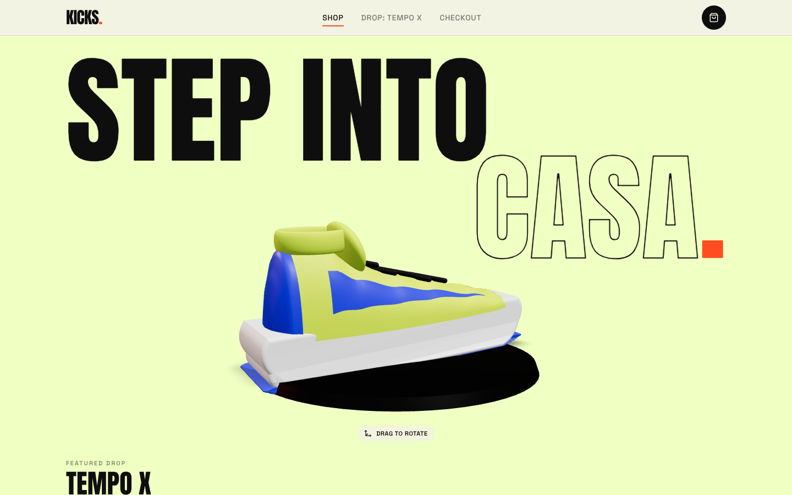
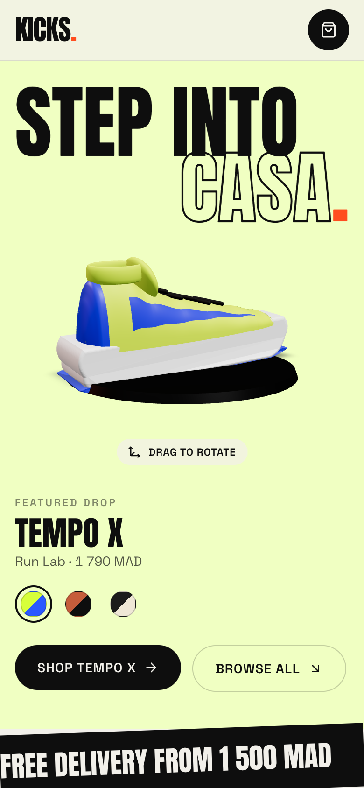

# KICKS — Sneaker Store

> A bold, editorial sneaker e-commerce front-end for a Casablanca concept store, with a drag-to-rotate 3D sneaker, an add-to-cart animation that flies into the bag, and a four-step checkout.



<p align="center"></p>

## Features

- **3D product turntable** in the hero, built with React Three Fiber from code only: the upper is a lofted surface (cross-sections swept along a foot-shaped planform that follows the SVG profile), the sole is an extruded, tapered profile, and the stripe and heel tab are surface patches. Drag to rotate (`PresentationControls`), switch colourways and the 3D shoe recolours instantly. Lazy-loaded, DPR capped at 2, camera adapts to portrait screens, SVG fallback without WebGL.
- **Editorial hero**: oversized Anton headline whose two lines drift apart with scroll (`useScroll` + `useTransform`), a background that cross-fades to each featured colourway, and magnetic CTAs.
- **Product grid** with animated category tabs (`layoutId`), sorting, layout-animated re-ordering, and cards whose shoe lifts and tilts on hover.
- **Add-to-cart flight**: the shoe artwork is cloned and flies along an arc into the bag icon, which bounces when it lands; the badge count pops in.
- **Product page**: gallery with side, medial, toe and heel views (spring-animated framing of one SVG), a 360° tab that loads the 3D model, a size picker with a sliding selection, shake + message if no size is chosen, accordion details and related products.
- **Cart drawer**: spring slide-over with quantity steppers (rolling numbers), remove, free-shipping rule (from 1 500 MAD), totals in MAD and an animated empty state. Cart persists in `localStorage`.
- **Checkout stepper**: Shipping, Delivery, Payment, Review with direction-aware slide transitions (`AnimatePresence` + `custom`), validation for Moroccan phone numbers, cash or card on delivery, a live summary and an animated confirmation.
- **Route transitions** with a volt wipe panel, and a header that hides on scroll down and returns on scroll up.
- Responsive from 375px; honours `prefers-reduced-motion` (the flight animation is skipped entirely).

## Tech stack


## Getting started

```bash
npm install
npm run dev      # http://localhost:5173
npm run build    # production build in dist/
npm run preview  # serve the production build
```

`vercel.json` rewrites all paths to `index.html` so `/product/:id` and `/checkout` survive a refresh.

## Project structure

```
src/
├── components/
│   ├── Navbar.jsx        # hide-on-scroll header, bouncing bag icon
│   ├── CartDrawer.jsx    # slide-over cart
│   ├── ProductCard.jsx   # hover tilt + quick add
│   ├── ShoeArt.jsx       # recolourable SVG sneaker
│   ├── Magnetic.jsx
│   └── Footer.jsx
├── context/
│   └── CartContext.jsx   # cart state, persistence, fly-to-cart layer
├── pages/
│   ├── Home.jsx          # 3D hero, ticker, shop grid
│   ├── Product.jsx       # gallery, 360° view, size picker
│   └── Checkout.jsx      # stepper + confirmation
├── three/
│   ├── Shoe3D.jsx        # procedural 3D sneaker + turntable
│   └── webgl.js
├── data/products.js      # 10 mock sneakers, prices in MAD
├── App.jsx               # routes + page wipe transition
└── main.jsx
```

## Design notes

**Palette** — a warm paper background (`#F2F0EA`) and jet black (`#0E0E0E`) give a printed, streetwear-zine feel. A single loud "volt" orange (`#FF4D1F`) carries every action, with acid lime (`#D7FF3A`) used once, for the order total. Each product brings its own pastel tile colour, so the grid stays lively while the UI chrome stays monochrome.

**Typography** — [Anton](https://fonts.google.com/specimen/Anton) for condensed, poster-scale headlines (up to 13rem) and outlined counter-type, paired with [Space Grotesk](https://fonts.google.com/specimen/Space+Grotesk) for UI text, prices and labels.

**Motion** — loud but controlled:
- The page wipe and the headline drift give the store a "campaign" energy; product cards use springy hover tilts.
- The add-to-cart flight follows a three-keyframe arc with custom easing so it reads as being *thrown* into the bag; the bag responds with a squash-and-stretch bounce.
- Checkout steps slide in the direction of travel, so going back feels like going back.
- The 3D turntable sways between the two three-quarter views instead of spinning, so the shoe's profile always reads.
- `MotionConfig reducedMotion="user"` plus `useReducedMotion` in the cart context.

## Author

**Zakaria Dabella** — UI/UX designer & web developer based in Casablanca, Morocco.

- Portfolio: [zakaria-dabella-portfolio.vercel.app](https://zakaria-dabella-portfolio.vercel.app/)
- GitHub: [@zakaria10-dabella](https://github.com/zakaria10-dabella)

## License

[MIT](LICENSE) © 2026 Zakaria Dabella
